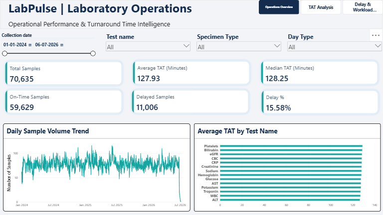
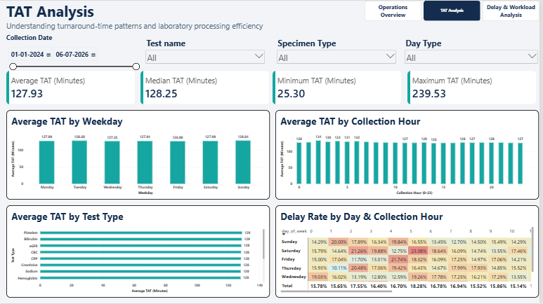

# 🔬 LabPulse – Laboratory Operations & Intelligence Dashboard

An end-to-end healthcare data analytics project that transforms synthetic laboratory data into actionable insights using Python, SQL, MySQL, and Power BI.

---

## 📌 1. Project Overview

**LabPulse** is a healthcare analytics project designed to analyze diagnostic laboratory operations, monitor turnaround time (TAT), identify processing delays, and understand sample workload patterns.

The project follows an end-to-end data analytics workflow, including data extraction, data cleaning, exploratory data analysis, SQL-based analysis, and interactive Power BI dashboard development.

The objective is to demonstrate how data analytics can help monitor laboratory performance and identify potential operational bottlenecks.

## 🎯 2. Business Objectives

- Monitor overall laboratory sample volume and processing performance.
- Analyze average, median, minimum, and maximum turnaround time.
- Identify tests with relatively higher turnaround times and delay rates.
- Understand workload patterns across weekdays and collection hours.
- Identify day-and-hour combinations with higher delay percentages.
- Develop an interactive dashboard for operational monitoring and analysis.

## 🛠️ 3. Technology Stack

| Technology | Purpose |
|---|---|
| Python | Data cleaning, feature engineering and EDA |
| Pandas | Data manipulation and analysis |
| NumPy | Numerical operations |
| Matplotlib | Data visualization |
| Seaborn | Statistical visualization |
| SQL | Data querying and analytical calculations |
| MySQL | Data storage and querying |
| Power BI | Interactive dashboard development |
| Jupyter Notebook | Python analysis and documentation |

## 📂 4. Dataset Information

- **Dataset:** Synthetic healthcare laboratory data
- **Source:** Auric Grid Synthetic Hospital Interoperability Environment
- **Analyzed records:** 70,635 laboratory result records
- **Analysis unit:** Laboratory result record

The original dataset contained multiple healthcare event types. Laboratory result records were extracted and prepared for the analysis.

**Data Disclaimer:** This project uses synthetic data for educational and portfolio purposes. It does not represent actual patient records or the operational performance of any real diagnostic laboratory.

## 🔄 5. Project Workflow

1. **Data Extraction:** Retrieved laboratory-related records from the synthetic healthcare dataset.
2. **Data Cleaning:** Inspected missing values, data types, and data consistency.
3. **Feature Engineering:** Prepared turnaround time, collection hour, weekday, and delay classification fields.
4. **Exploratory Data Analysis:** Analyzed sample volume, turnaround time, and delay patterns using Python.
5. **SQL Analysis:** Used MySQL to perform aggregations, operational analysis, and data validation.
6. **Dashboard Development:** Built an interactive three-page Power BI dashboard.
7. **Insights:** Identified patterns in laboratory workload and turnaround-time performance.

## 📊 6. Key Performance Indicators

| KPI | Result |
|---|---:|
| Total Samples | 70,635 |
| Average TAT | 127.93 minutes |
| Median TAT | 128.25 minutes |
| Minimum TAT | 25.30 minutes |
| Maximum TAT | 239.53 minutes |
| Delayed Samples | 11,014 |
| Delay Percentage | 15.59% |

**Delay Classification:** Samples with a turnaround time greater than or equal to 180 minutes are classified as delayed.

*Note: The 180-minute threshold is an exploratory analytical assumption and does not represent an official laboratory SLA.*

## 📈 7. Power BI Dashboard

The interactive Power BI dashboard consists of three analytical pages.

### Page 1 – Operations Overview

Provides a high-level view of laboratory performance.

- Total samples and turnaround-time KPIs.
- Daily sample volume trend.
- Average TAT by test name.
- Interactive filtering by date, test name, specimen type, and day type.



### Page 2 – TAT Analysis

Focuses on turnaround-time patterns and processing efficiency.

- Average TAT by weekday.
- Average TAT by collection hour.
- Average TAT by test type.
- Delay rate by day and collection hour using a matrix heatmap.



### Page 3 – Delay & Workload Analysis

Examines operational delays and sample workload patterns.

- Delay rate by test name.
- Delay rate by weekday.
- Delay rate by collection hour.
- Sample workload by collection hour.


## 🔍 8. Key Analytical Findings

The analysis identified the following patterns in the synthetic dataset:

- Overall average turnaround time was approximately 127.93 minutes.
- Approximately 15.59% of laboratory result records crossed the exploratory 180-minute delay threshold.
- Sample volume was highest around 7 PM, with 4,071 records.
- Weekday and weekend average turnaround times were relatively similar.
- Daily sample volume and average TAT showed a very weak negative correlation.

These findings describe the analyzed synthetic dataset and should not be interpreted as actual laboratory operational performance.

## 📁 9. Repository Structure

```text
LabPulse/
│
├── data/
│   └── README.md
│
├── python/
│   └── labpulse_analysis.ipynb
│
├── sql/
│   └── labpulse_analysis.sql
│
├── powerbi/
│   └── LabPulse_Dashboard.pbix
│
├── screenshots/
│   ├── Operations_Overview.png
│   ├── TAT_Analysis.png
│   └── Delay_Workload Analysis.png
│
├── documentation/
│   └── methodology.md
│
└── README.md
```

## ⚠️ 10. Limitations

- The dataset is synthetic and does not represent actual laboratory operations.
- The 180-minute delay threshold is exploratory.
- Correlation does not establish causation.
- Results may differ when applied to real-world laboratory datasets.
- Findings are limited to the available fields and records.

## 🚀 11. Future Improvements

- Develop predictive models for laboratory turnaround-time estimation.
- Implement anomaly detection for unusual processing delays.
- Introduce configurable laboratory SLA monitoring.
- Automate data refresh and reporting.
- Explore advanced statistical analysis and operational forecasting.

## 👨‍💻 12. Author

**Mohit Kattungal**

Final-Year B.Tech Computer Science & Engineering (Data Science) Student

Interested in Data Analytics, Data Science, and Machine Learning.

---

⭐ If you find this project interesting, feel free to explore the repository and its analytical workflow.
